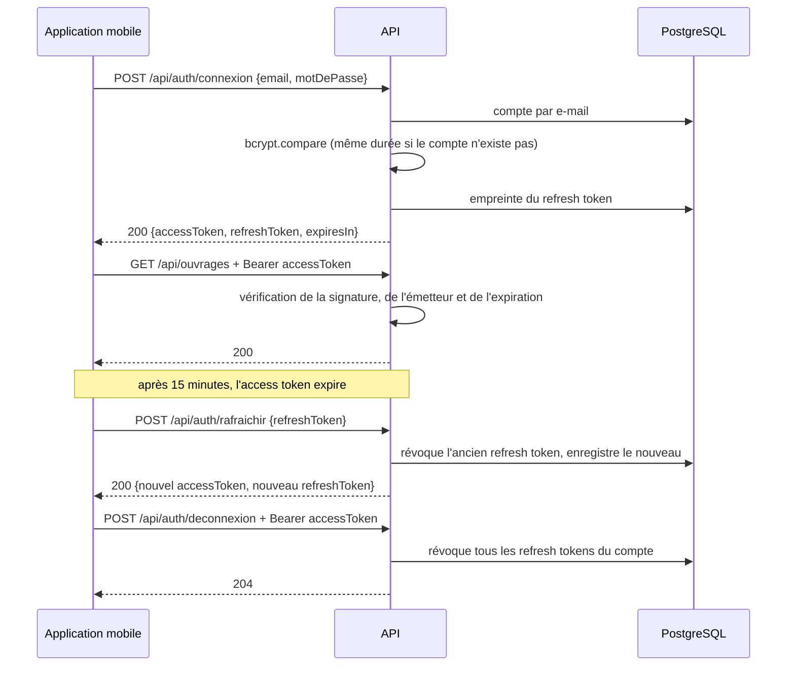

# Médiathèque API

API REST d'une médiathèque associative : gestion du catalogue d'ouvrages, des comptes et des emprunts,
pensée pour être consommée par une application mobile et exposée sur Internet.

- **Stack** : Node.js 24, Express 5, Zod 4, Prisma 7, PostgreSQL 17, jose, bcrypt.
- **Architecture** : routes, services, dépôts et middlewares séparés, gestionnaire d'erreurs central.
- **Sécurité** : JWT court et refresh token révocable, rôles et contrôle de propriété, helmet, CORS, limitation de débit.
- **Qualité** : validation de toutes les entrées, transactions, tests automatisés et intégration continue.

## Sommaire

- [Prérequis](#prérequis)
- [Installation](#installation)
- [Comptes de démonstration](#comptes-de-démonstration)
- [Variables d'environnement](#variables-denvironnement)
- [Authentification](#authentification)
- [Rôles et droits par route](#rôles-et-droits-par-route)
- [Ressources](#ressources)
- [Sécurité](#sécurité)
- [Tests et intégration continue](#tests-et-intégration-continue)
- [Architecture](#architecture)
- [Choix techniques](#choix-techniques)

## Prérequis

- Node.js 24 ou plus récent.
- Docker et Docker Compose, pour PostgreSQL. Une instance PostgreSQL existante convient aussi.

## Installation

```bash
cp .env.example .env          # puis renseigner JWT_ACCESS_SECRET (voir plus bas)
npm ci                        # installe et génère le client Prisma
npm run db:up                 # démarre PostgreSQL dans Docker (bases mediatheque et mediatheque_test)
npx prisma migrate deploy     # applique les migrations
npm run seed                  # 3 comptes, 10 ouvrages, 3 emprunts dont 1 rendu
npm run dev                   # API sur http://localhost:3000
```

Vérification : `curl http://localhost:3000/sante` répond `{"statut":"ok","base":"ok"}`.

Si le port 5432 est déjà pris sur la machine, changer `DB_PORT` et le port de `DATABASE_URL` dans `.env`.

| Commande | Effet |
| -------- | ----- |
| `npm run dev` | lance l'API avec rechargement automatique |
| `npm start` | lance l'API |
| `npm test` | lance les tests sur la base de test |
| `npm run db:up` | démarre PostgreSQL avec Docker Compose |
| `npm run db:migrate` | crée et applique une migration en développement |
| `npm run db:deploy` | applique les migrations en attente |
| `npm run seed` | insère les données de démonstration, rejouable sans doublon |

## Comptes de démonstration

Créés par `npm run seed`. Adresses et mots de passe **fictifs**, réservés au développement local.

| E-mail | Mot de passe | Rôle |
| ------ | ------------ | ---- |
| `bibliothecaire@example.net` | `Demo-Biblio-2026!` | bibliothecaire |
| `camille@example.net` | `Demo-Camille-2026!` | membre |
| `noe@example.net` | `Demo-Noe-2026!` | membre |

## Variables d'environnement

| Variable | Rôle | Défaut |
| -------- | ---- | ------ |
| `PORT` | port d'écoute de l'API | `3000` |
| `DATABASE_URL` | chaîne de connexion PostgreSQL | obligatoire |
| `DB_PORT` | port hôte publié par `docker compose` | `5432` |
| `JWT_ACCESS_SECRET` | secret de signature des access tokens, 32 caractères au moins | obligatoire |
| `ACCESS_TOKEN_TTL_SECONDS` | durée de vie d'un access token, plafonnée à 900 s | `900` |
| `REFRESH_TOKEN_TTL_DAYS` | durée de vie d'un refresh token | `7` |
| `BCRYPT_COST` | coût bcrypt, jamais inférieur à 12 | `12` |
| `CORS_ORIGINS` | origines autorisées, séparées par des virgules | aucune |
| `AUTH_RATE_LIMIT_MAX` | tentatives par quart d'heure sur `/api/auth/*` | `10` |
| `GLOBAL_RATE_LIMIT_MAX` | requêtes par minute sur toute l'API | `300` |
| `TRUST_PROXY` | nombre de proxys de confiance (adresse IP réelle du client) | `0` |

`.env` et `.env.test` ne sont jamais versionnés. Les fichiers `.env.example` et `.env.test.example`
ne contiennent que des valeurs factices.

### Générer un secret

```bash
node -e "console.log(require('node:crypto').randomBytes(48).toString('base64url'))"
# ou
openssl rand -base64 48
```

Un secret par environnement, jamais commité, jamais partagé entre développement, test et production.
Changer le secret invalide immédiatement tous les access tokens en circulation.

## Authentification

L'API utilise deux jetons :

- **access token** : JWT HS256 signé avec jose, valable 15 minutes au plus. Il ne contient que l'identifiant
  (`sub`) et le rôle, jamais d'e-mail ni de mot de passe. Il est envoyé dans `Authorization: Bearer <jeton>`.
- **refresh token** : chaîne aléatoire de 48 octets, valable 7 jours. Seule son empreinte SHA-256 est stockée
  en base, il est révocable à tout moment.



**Rotation et détection de vol** : chaque rafraîchissement révoque le refresh token utilisé.
Si un jeton déjà révoqué est présenté à nouveau, il a forcément été copié : tous les refresh tokens
du compte sont révoqués et l'utilisateur doit se reconnecter.

| Méthode | Route | Corps | Succès | Erreurs |
| ------- | ----- | ----- | ------ | ------- |
| POST | `/api/auth/inscription` | `email`, `motDePasse` (12 caractères au moins) | 201 | 400, 409, 429 |
| POST | `/api/auth/connexion` | `email`, `motDePasse` | 200 | 400, 401, 429 |
| POST | `/api/auth/rafraichir` | `refreshToken` | 200 | 400, 401, 429 |
| POST | `/api/auth/deconnexion` | aucun | 204 | 401, 429 |
| GET | `/api/auth/moi` | aucun | 200 | 401, 429 |

L'inscription crée toujours un **membre** : un champ `role` envoyé par le client est ignoré.
La connexion renvoie le même 401 que le compte existe ou non.

## Rôles et droits par route

| Route | Anonyme | Membre | Bibliothécaire |
| ----- | :-----: | :----: | :------------: |
| `GET /sante` | oui | oui | oui |
| `POST /api/auth/inscription`, `/connexion`, `/rafraichir` | oui | oui | oui |
| `POST /api/auth/deconnexion`, `GET /api/auth/moi` | 401 | oui | oui |
| `GET /api/ouvrages`, `GET /api/ouvrages/:id` | 401 | oui (seuls ses emprunts en cours sont joints) | oui |
| `POST`, `PATCH`, `DELETE /api/ouvrages` | 401 | 403 | oui |
| `GET /api/emprunts` | 401 | ses emprunts uniquement | tous |
| `GET /api/emprunts/:id` | 401 | le sien, sinon 403 | tous |
| `POST /api/emprunts` | 401 | pour lui-même | pour lui ou pour un membre (`emprunteurId`) |
| `PATCH /api/emprunts/:id` | 401 | le sien, sinon 403 | tous |
| `POST /api/emprunts/:id/retour` | 401 | le sien, sinon 403 | tous |
| `DELETE /api/emprunts/:id` | 401 | 403 | oui |

Le schéma de `PATCH /api/emprunts/:id` n'accepte que `retourPrevuLe` : ni l'ouvrage, ni le propriétaire,
ni l'état rendu ne peuvent changer par cette route.

## Ressources

Toutes les réponses sont en JSON. Les listes sont paginées avec `?page=` (défaut 1) et `?limite=` (défaut 10, 50 au plus).

```json
{ "donnees": [], "page": 1, "limite": 10, "total": 42, "pages": 5 }
```

### Ouvrages

| Méthode | Route | Succès | Erreurs |
| ------- | ----- | ------ | ------- |
| GET | `/api/ouvrages?disponible=true` | 200 | 400, 401 |
| GET | `/api/ouvrages/:id` (avec les emprunts en cours visibles) | 200 | 400, 401, 404 |
| POST | `/api/ouvrages` | 201 | 400, 401, 403 |
| PATCH | `/api/ouvrages/:id` | 200 | 400, 401, 403, 404 |
| DELETE | `/api/ouvrages/:id` | 204 | 400, 401, 403, 404, 409 |

Champs : `titre` (1 à 150 caractères), `auteur` (1 à 120 caractères), `annee` (entier de 1450 à l'année courante).
`disponible` est en lecture seule : il découle des emprunts.
La suppression renvoie 409 si l'ouvrage est emprunté ou s'il a un historique d'emprunts.

### Emprunts

| Méthode | Route | Succès | Erreurs |
| ------- | ----- | ------ | ------- |
| GET | `/api/emprunts?rendu=false&ouvrageId=1` | 200 | 400, 401 |
| GET | `/api/emprunts/:id` | 200 | 400, 401, 403, 404 |
| POST | `/api/emprunts` | 201 | 400, 401, 404, 409 |
| PATCH | `/api/emprunts/:id` | 200 | 400, 401, 403, 404 |
| DELETE | `/api/emprunts/:id` | 204 | 400, 401, 403, 404 |
| POST | `/api/emprunts/:id/retour` | 200 | 400, 401, 403, 404, 409 |

Champs : `ouvrageId`, `emprunteurId` (bibliothécaire uniquement), `empruntLe` (date ISO, maintenant par défaut),
`retourPrevuLe` (date ISO, postérieure à l'emprunt).

Règles :
- créer un emprunt rend l'ouvrage indisponible dans la même transaction ; un ouvrage déjà emprunté renvoie 409 sans rien écrire ;
- le retour marque l'emprunt rendu et l'ouvrage disponible ensemble ; un second retour renvoie 409 ;
- supprimer un emprunt en cours libère l'ouvrage.

### Format des erreurs

```json
{
  "erreur": "Données invalides",
  "details": [{ "champ": "body.annee", "message": "Trop petit : nombre doit être >=1450" }]
}
```

| Cause | Statut |
| ----- | ------ |
| validation Zod, identifiant mal formé, JSON invalide | 400 |
| jeton absent, invalide, expiré ou signé par un autre secret | 401 |
| rôle insuffisant, ressource d'un autre membre, origine CORS non déclarée | 403 |
| ressource absente (dont Prisma `P2025`) | 404 |
| conflit métier, clé étrangère (`P2003`), doublon (`P2002`) | 409 |
| corps JSON de plus de 100 Ko | 413 |
| limite de débit atteinte | 429 |
| erreur inattendue, journalisée côté serveur uniquement | 500 |

Aucune réponse ne contient de pile d'exécution ni de message interne.

### Exemples de requêtes

Le fichier [`requetes.http`](requetes.http) couvre toutes les routes, cas d'erreur compris,
avec l'extension REST Client de VS Code. Avec curl :

```bash
# Connexion
TOKEN=$(curl -s -X POST http://localhost:3000/api/auth/connexion \
  -H "Content-Type: application/json" \
  -d '{"email":"camille@example.net","motDePasse":"Demo-Camille-2026!"}' | node -p "JSON.parse(require('fs').readFileSync(0)).accessToken")

# Ouvrages disponibles
curl "http://localhost:3000/api/ouvrages?disponible=true" -H "Authorization: Bearer $TOKEN"

# Emprunter l'ouvrage 2
curl -X POST http://localhost:3000/api/emprunts \
  -H "Authorization: Bearer $TOKEN" -H "Content-Type: application/json" \
  -d '{"ouvrageId": 2, "retourPrevuLe": "2030-01-15"}'
```

## Sécurité

| Mesure | Mise en œuvre |
| ------ | ------------- |
| Mots de passe | bcrypt, coût 12 au minimum, 72 octets au plus ; jamais renvoyés, jamais journalisés |
| Énumération de comptes | même 401 et même durée de réponse que le compte existe ou non |
| Jetons | access token de 15 minutes, refresh token stocké sous forme d'empreinte, rotation, révocation |
| Autorisation | middleware Bearer, contrôle de rôle sur les routes, contrôle de propriété dans les services |
| Affectation de masse | schémas Zod stricts : `role`, `emprunteurId` ou `rendu` ne passent que là où c'est prévu |
| En-têtes | helmet (CSP, `nosniff`, HSTS, etc.) et `X-Powered-By` supprimé |
| CORS | origines limitées à `CORS_ORIGINS`, toute autre origine reçoit 403 |
| Force brute | 10 requêtes par quart d'heure et par IP sur `/api/auth/*`, 300 par minute sur l'API |
| Taille des corps | 100 Ko au plus pour le JSON |
| Secrets | lus depuis l'environnement, longueur minimale contrôlée au démarrage, absents du dépôt |
| Dépendances | `npm audit --audit-level=high` à chaque pull request |

## Tests et intégration continue

Les tests utilisent `node:test` et `fetch` contre l'application démarrée sur un port éphémère (`listen(0)`),
avec une **base distincte** de la base de développement.

```bash
cp .env.test.example .env.test   # adapter le port si besoin
npm test
```

Avant les suites, les migrations sont appliquées sur la base de test. Un garde-fou refuse de lancer
les tests si le nom de la base ne contient pas `test`. Chaque fichier repart d'une base vide.

| Fichier | Couverture |
| ------- | ---------- |
| `test/auth.test.js` | inscription, doublon, connexion réussie et échouée, jeton absent ou forgé, rotation, vol de refresh token, déconnexion |
| `test/access.test.js` | 403 sur rôle insuffisant, propriété des emprunts, PATCH sans changement de propriétaire |
| `test/hardening.test.js` | en-têtes helmet, CORS, 413, réponse sans pile, 429 à la onzième tentative |

Le workflow [`.github/workflows/ci.yml`](../.github/workflows/ci.yml) s'exécute à chaque pull request :
service PostgreSQL, `npm ci`, `npm audit --audit-level=high` puis `npm test`.
Le secret JWT de la CI est généré à chaque exécution.

## Architecture

```
prisma/
  schema.prisma          modèles Utilisateur, RefreshToken, Ouvrage, Emprunt
  migrations/            historique SQL versionné
  seed.js, seed-data.js  seeder rejouable et ses données
prisma.config.ts         connexion, migrations et commande de seed
src/
  index.js               démarrage et arrêt propre
  app.js                 assemblage : sécurité, middlewares, routeurs, 404, erreurs
  config.js              lecture et contrôle de l'environnement
  erreurs.js             HttpError et traduction des erreurs Prisma et jose
  domain/roles.js        rôles de l'API
  db/prisma.js           client Prisma avec l'adaptateur pg
  security/              hachage des mots de passe, émission et vérification des jetons
  routes/                un routeur par ressource, HTTP uniquement
  services/              règles métier, droits de propriété et transactions
  repositories/          requêtes Prisma, seul endroit qui parle à la base
  schemas/               schémas Zod partagés et par ressource
  middlewares/           authentification, rôles, sécurité, validation, journal, erreurs
test/                    tests d'intégration et leur contexte partagé
docker/                  initialisation de la base de test
requetes.http            scénarios de test manuels
```

Le flux d'une requête : **sécurité** (helmet, CORS, débit) puis **authentification** puis **route**
(rôle et validation Zod) puis **service** (règles métier et propriété) puis **dépôt** (Prisma).

`app.js` reçoit le client Prisma et la configuration en paramètres et ne démarre pas de serveur :
les tests construisent ainsi une application par suite, avec leurs propres limites.

## Choix techniques

- **PostgreSQL et Prisma** : les emprunts demandent des transactions et des clés étrangères fiables.
  Prisma apporte des migrations versionnées et un client typé.
- **bcrypt** : implémentation native exécutée dans le pool de threads de libuv, la boucle d'événements
  reste disponible pendant un hachage.
- **Refresh token opaque** : un simple aléa stocké en empreinte suffit, puisqu'il est toujours vérifié en base.
  Un JWT n'apporterait rien et ne serait pas révocable sans cette même table.
- **Concurrence** : l'ouvrage est réservé par une mise à jour conditionnelle (`disponible = true`) ;
  deux emprunts simultanés du même ouvrage donnent un 201 et un 409, jamais deux emprunts.
  Le même principe protège la rotation des refresh tokens.
- **Migration des emprunts** : l'emprunteur devient une référence à un compte. Les emprunts de démonstration
  du TP 1 portaient un nom libre impossible à rattacher : la migration les supprime, le seeder les recrée.
